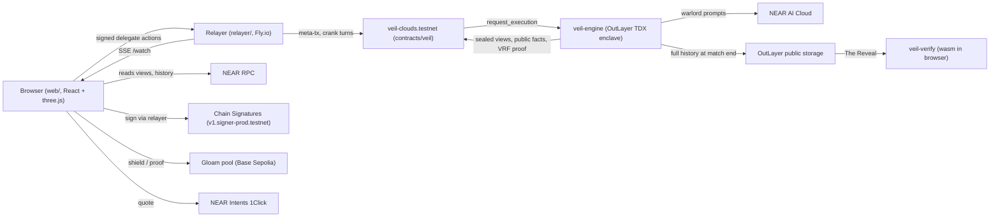
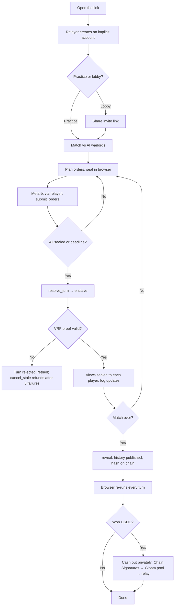

# VEIL

A fog-of-war strategy game on NEAR where even the developer cannot see the map.

  [](https://veil.mrfomolabs.xyz)

VEIL is a turn-based war game for 2 to 6 seats, filled by players and AI warlords. The hidden game state lives inside an Intel TDX enclave on OutLayer. Every turn's dice carry a VRF proof that the NEAR contract checks before it accepts the turn. When a match ends, the whole hidden history is published, and your browser re-runs every turn to prove nobody cheated. Winnings can leave privately through Gloam on Base, signed by your NEAR account with Chain Signatures.

Built for the NEAR hackathon. Tracks: **games** (primary), **privacy**, **open**.

## Demo

- **Play now (testnet, free, no wallet):** https://veil.mrfomolabs.xyz
- **Walkthrough film (2:51):** a full match, narrated, explaining each piece of tech as it appears.
  > 🎥 Demo video: https://youtu.be/Vpn6Os-3_SE


## Contents

- [Problem](#problem)
- [Solution](#solution)
- [How to test](#how-to-test)
- [Architecture](#architecture)
- [Flowchart](#flowchart)
- [Tech stack](#tech-stack)
- [Getting started](#getting-started)
- [Project structure](#project-structure)
- [Deployment](#deployment)
- [Usage / API](#usage--api)
- [Roadmap](#roadmap)
- [Contributing](#contributing)
- [License](#license)
- [Acknowledgements](#acknowledgements)

## Problem

Strategy games depend on hidden information. Online, someone's server always holds the whole map, so players have to trust that it doesn't peek, leak, or tilt the dice. Nothing lets a player check this afterwards.

On a public blockchain it's worse. Every transaction is visible, so a move sent on chain is a move your opponent can read. That's why on-chain strategy games mostly avoid fog of war. Payouts have the same problem: once you win, everyone can follow the money to your wallet.

## Solution

VEIL moves the hidden state somewhere no one can read it, and makes every result checkable.

- Your orders are sealed in the browser to a key that exists only inside an OutLayer enclave. The chain stores ciphertext.
- The enclave resolves each turn, using randomness that comes with a proof. The contract checks that proof before it accepts the turn.
- After the match, the enclave publishes the full history and the contract records its hash. Your browser re-runs every turn with the same Rust rules, compiled to wasm, and compares the result with what the chain recorded while the match was hidden.

**What is hidden, and from whom**

| Party | Sees |
|---|---|
| Other players | Public facts (battle coordinates, eliminations, tile counts) and their own view |
| Chain observers | Order and view ciphertexts, public facts, VRF proofs |
| The developer | The same as a chain observer. The game key is derived in the TEE per match. The state key is bound to the contract as caller and to the exact engine build. The VRF rules out re-rolls |
| OutLayer operator | Cannot read TDX memory. Can refuse to run, which is a liveness failure covered by `cancel_stale` |
| Everyone, after the match | Everything (The Reveal) |

### Key features

- **Sealed orders.** X25519 + HKDF-SHA256 + XChaCha20-Poly1305 in the browser. Orders are padded to 1024 bytes and bound to `match | turn | seat`.
- **Verifiable dice.** An OutLayer VRF value is taken once per turn. The contract checks `ed25519(signature, alpha)` and `sha256(signature) = output`, and that `alpha` names this exact turn.
- **The Reveal.** Your browser runs the Rust verifier over the published history and checks every order, roll and commitment.
- **AI warlords.** They fill empty seats and decide inside the enclave from their own fog only. They sell intel and truces from their own USDC treasuries, and The Reveal checks those trades too.
- **No wallet, no gas.** A relayer creates an implicit account for each player and pays for their actions with NEP-366 meta-transactions.
- **Private cash-out.** Through Chain Signatures, your NEAR account controls a Base address. From there, winnings go into Gloam's shielded pool and out through Gloam's relay, with a zero-knowledge proof made in your browser.
- **Every input.** Mouse, touch, keyboard, or a gamepad (DualSense, DualShock 4, Xbox), across the whole game including menus and the vault.

## How to test

### Live (fastest)

Open https://veil.mrfomolabs.xyz. You don't need a wallet, faucet or sign-up: the relayer creates a testnet account in your browser.

**Try this**

1. **PLAY → tutorial.** In 2 minutes you march, recruit, seal real ciphertext, verify a real VRF signature and lift the veil. *Expected:* the tutorial ends on "Play vs 3 warlords".
2. **Click your capital, then a neighbouring island; drag Recruit; press Seal & send orders.** *Expected:* a seal mark shows on your seat within a few seconds (the meta-transaction landed).
3. **Wait for the turn to resolve.** *Expected:* clouds burn off where your troops can now see, and any battles you fought appear in the feed.
4. **Click a ⛨ shield in the top right.** *Expected:* the sheet re-checks that turn's VRF signature, `output = sha256(signature)`, and that the proof names this turn, in your browser.
5. **Play to the end → Open The Reveal.** *Expected:* the fog is gone, you can scrub through every turn and order, and the panel says *✔ Verified: all N turns re-run*.
6. **Multiplayer:** Lobbies → Open a lobby → copy the invite link → open it in a private window → Join. *Expected:* the match starts by itself when the lobby is full.

### Private cash-out (Base Sepolia)

The vault runs on Base Sepolia. To try a deposit, fund the derived Base address it shows with Base Sepolia ETH and test USDC from public faucets. On testnet the NEAR → Base bridge step isn't available, so the app shows a live mainnet 1Click quote in its place.

### Automated tests

```bash
make test
```

This runs the rules (including 1,000 bot matches and a fog-leak property suite), crypto, engine end-to-end, verifier, contract, web client and relayer tests. Passing means `cargo test` reports `test result: ok` for each crate, and Vitest and `node --test` finish with zero failures.

To play a full match headlessly and re-run it with the native verifier (needs a running devnet from `make dev`):

```bash
make simulate
```

## Architecture



- **Browser (`web/`):** seals orders, opens its own view, renders the 3D map, runs the verifier, and handles the vault (Chain Signatures signer, Gloam shield and unshield, Groth16 proving in a worker).
- **Relayer (`relayer/`):** pays gas for players' meta-transactions, creates implicit accounts, relays Chain Signatures `sign` calls (secp256k1, `veil-` paths only), passes cash-outs to Gloam's relay, cranks turns on a timer, and streams match changes over SSE.
- **Contract (`contracts/veil`):** seats, buy-ins, the turn clock and ciphertexts. It verifies the VRF before accepting a turn, stores views and public facts, keeps the warlords' treasuries, and pays out.
- **Engine (`engine/`, on OutLayer):** decrypts orders, runs the AI seats, resolves the turn with `veil-rules`, compare-and-swaps the sealed state, and seals each player's view to their key.
- **Verifier (`crates/veil-verify`, `crates/veil-wasm`):** re-runs a revealed match and checks VRF proofs, commitments and the on-chain ciphertexts, natively or in the browser.

If no NEAR AI key is configured, or the model call fails, the warlords fall back to the built-in heuristic bot.

Details: [docs/protocol.md](docs/protocol.md) · [docs/threat-model.md](docs/threat-model.md)

## Flowchart



## Tech stack

| Area | Tools |
|---|---|
| Frontend | React 18, Vite 5, three.js with react-three-fiber and drei, zustand, TypeScript |
| Game logic | Rust: `veil-rules`, `veil-crypto`, `veil-verify`, and `veil-wasm` for the browser |
| Enclave | OutLayer (Intel TDX), engine built for `wasm32-wasip2` |
| AI | NEAR AI Cloud (Confidential-TEE models), called from inside the enclave; heuristic bot as the fallback |
| Blockchain | NEAR (near-sdk 5, near-api-js, NEP-366 meta-transactions, NEP-413), Chain Signatures, NEAR Intents 1Click, Base Sepolia |
| Privacy | Gloam (`@gloamtrade/sdk`), snarkjs (Groth16), viem, @noble crypto |
| Infra | Vercel (web), Fly.io (relayer, one machine), keyed and free NEAR RPCs with rotation |
| Tooling | cargo, cargo-near, Vitest, `node --test`, HyperFrames (demo film) |

## Getting started

### Prerequisites

- Rust with the `wasm32-unknown-unknown` and `wasm32-wasip2` targets
- Node 20+ (the relayer image uses Node 22)
- For testnet deploys: [near-cli](https://github.com/near/near-cli-rs), `outlayer` CLI, `flyctl`, and the `vercel` CLI

### Installation

```bash
git clone https://github.com/mrfomoweb3/veil.git
cd veil
rustup target add wasm32-unknown-unknown wasm32-wasip2
(cd web && npm ci)
(cd relayer && npm ci)
```

### Environment variables

**Web (`web/.env`, copy from `web/.env.example`).** Every `VITE_*` value ends up in public JavaScript, so never put a secret here.

| Variable | Purpose | Required |
|---|---|---|
| `VITE_NETWORK` | `devnet` (local Practice), `testnet` or `mainnet` | Yes |
| `VITE_DEVNET_API` | Devnet server URL, e.g. `http://localhost:8787` | devnet only |
| `VITE_VEIL_CONTRACT` | Game contract account | testnet / mainnet |
| `VITE_RELAYER_URL` | Relayer base URL | testnet / mainnet |
| `VITE_OUTLAYER_API` | OutLayer API, e.g. `https://testnet-api.outlayer.ai` | testnet / mainnet |
| `VITE_NEAR_RPC` | Comma-separated RPCs; free endpoints with rotation are used if unset | No |
| `VITE_MPC_CONTRACT` | Chain Signatures contract (defaults per network) | No |
| `VITE_GLOAM_ENV` | `testnet` (Base Sepolia, the default) or `mainnet` (Base) | No |
| `VITE_GLOAM_RELAY_URL` | The relayer's `/gloam-relay` passthrough (dev uses the Vite proxy) | Deployed builds |

**Relayer (`relayer/.env`, copy from `relayer/.env.example`)**

| Variable | Purpose | Required |
|---|---|---|
| `NEAR_NETWORK` | `testnet` or `mainnet` | Yes |
| `NEAR_RPC` | One RPC or several, comma-separated; rotates on any refusal | Yes |
| `VEIL_CONTRACT` | The only contract this relayer serves | Yes |
| `RELAYER_ACCOUNT` | The relayer's funded account | Yes |
| `RELAYER_PRIVATE_KEY` | The relayer's key. If unset, it's read from `~/.near-credentials`. Use a secret store on servers and never commit it | On servers |
| `MPC_CONTRACT` | Chain Signatures contract whose `sign` calls the relayer pays for | Yes |
| `ENGINE_DEPOSIT_NEAR` | NEAR attached to each enclave run; the unused part is refunded | No (0.05) |
| `ONBOARD_NEAR` | NEAR sent to create each new player account | No (0.01) |
| `CRANK_EVERY_MS` | How often the cranker looks for due turns | No (5000) |
| `PORT` | HTTP port | No (8790) |
| `ALLOWED_ORIGINS` | Comma-separated web origins allowed to call the relayer | Yes |

### Run locally

```bash
make dev
```

This builds the engine and the verifier, starts the devnet (a local stand-in for the contract and OutLayer that drives the real engine) on `:8787`, and serves the web app at http://localhost:5173.

## Project structure

```
crates/veil-rules    deterministic game rules: map generation, resolution, vision, views, bot
crates/veil-crypto   ECIES shared by the engine and the verifier (the browser has the same in TS)
crates/veil-verify   re-runs a revealed match; checks VRF, commitments and on-chain ciphertexts
crates/veil-wasm     the verifier for the browser
engine/              the engine; engine/outlayer is the wasm32-wasip2 OutLayer project
contracts/veil       the game contract (near-sdk 5)
devnet/              local stand-in for the contract + OutLayer
relayer/             meta-tx relayer, turn cranker, Chain Signatures and Gloam passthrough
web/                 Vite + React + react-three-fiber client
  src/chain/         NEAR access, RPC rotation, friendly errors
  src/game/          match sync, orders, The Reveal replay, invites
  src/privacy/       Chain Signatures signer, 1Click bridge, Gloam vault, prover worker
  src/input/         keyboard, gamepad, focus navigation
scripts/             build, upload, deploy, simulate
docs/                protocol, threat model, deploy guide
video/film/          the HyperFrames walkthrough film (renders are not in git)
```

## Deployment

**Live**

| Piece | Where |
|---|---|
| Web app | https://veil.mrfomolabs.xyz (Vercel, root `web/`) |
| Relayer | Fly.io app `veil-relayer`, one always-on machine in `fra` |
| Game contract | [`veil-clouds.testnet`](https://testnet.nearblocks.io/address/veil-clouds.testnet) |
| Engine | OutLayer project `veil-clouds.testnet/veil-engine` |
| Relayer account | `veil-clouds-relay.testnet` |
| Chain Signatures | `v1.signer-prod.testnet`, path `veil-base-1` |
| Gloam USDC (Base Sepolia) | `0x036CbD53842c5426634e7929541eC2318f3dCF7e` |

**Private cash-out on Base Sepolia (2026-11-06).** The run happened in the app, signed by a NEAR testnet account through Chain Signatures:

| Step | Sent by | Tx |
|---|---|---|
| Approve USDC | the player's derived Base address `0x0488…D140` | [`0x4b8649b0…b6de`](https://sepolia.basescan.org/tx/0x4b8649b047b35df3c130a9a6de38149c9fec42c1b4497950cc88c84ec729b6de) |
| Shield 2 USDC into Gloam | the same address | [`0xf37c14a4…4482`](https://sepolia.basescan.org/tx/0xf37c14a4e8487e7763f1e4bbbfec3a865e18bbed478c87e0aa750114d10f4482) |
| Cash out to a fresh address (1.995 USDC arrived) | **Gloam's relay** `0xb1e9…512e`, not the player | [`0xad620269…835f`](https://sepolia.basescan.org/tx/0xad6202695ccbe00e47695feaa362a6351ecc38529038a4c6d81eb037abe3835f) |
| A second cash-out, same path | Gloam's relay | [`0xe5eee301…21c3`](https://sepolia.basescan.org/tx/0xe5eee3012a8501b9f3cf0e57d2c82d4922fb075b17b194d4900778825eac21c3) |
| A third cash-out, same path | Gloam's relay | [`0xc2438f7b…9db5`](https://sepolia.basescan.org/tx/0xc2438f7b8fcd831181ebc30ee405a494a20168abea105fe3634ec5cfd46c9db5) |

**What the cash-out keeps private**, stated plainly (the app has the same text under *What stays private?*):

- **Public:** the NEAR → Base transfer; the Base address (anyone can derive it from your NEAR account); the fact that it deposited into Gloam, and how much.
- **Private after the deposit:** which deposit a cash-out came from, and where the money went. Gloam's relay sends the cash-out, so your address doesn't appear on it.
- **Your part:** cash out to a fresh address and wait a while. An identical amount moments later is easy to match.

**Safety rails:**

- Each note is saved, encrypted with AES-GCM under a key derived from a NEP-413 signature, before its deposit is broadcast.
- The first deposit forces a backup download.
- Every Chain Signatures answer is recovered and must match your derived address before anything is broadcast.
- Spent notes are reconciled against the pool when the vault opens.

**Deploy your own (testnet)**

1. **Engine:**

   ```bash
   VEIL_CONTRACT=<you>.testnet PROJECT=veil-engine NEARAI_API_KEY=… scripts/upload-engine.sh
   ```

   This needs `outlayer login testnet` and prints the engine version hash.
2. **Contract:**

   ```bash
   CONTRACT=… OWNER=… ENGINE_PROJECT=<you>.testnet/veil-engine ENGINE_VERSION=<hash> USDC=… scripts/deploy-testnet.sh
   ```

3. **Relayer and web:** follow [docs/DEPLOY.md](docs/DEPLOY.md). The relayer runs on Fly.io with its key set as a secret, and the web app runs on Vercel.

## Usage / API

**Relayer HTTP**

| Endpoint | Purpose |
|---|---|
| `GET /health` | `{"ok":true,"network":…,"contract":…,"relayer":…}` |
| `GET /watch?match=<id>&account=<id>` | Server-sent events stream of match changes. One chain reader per match, fanned out to subscribers |
| `POST /onboard` | Creates the caller's implicit account |
| `POST /relay` | Submits a signed delegate action (NEP-366) to the game contract or the MPC signer |
| `POST /crank` | Nudges `start`, `resolve_turn` or `reveal` when one is due |
| `POST /gloam-relay` | Passes a Gloam unshield request through to Gloam's relay |

```bash
curl https://veil-relayer.fly.dev/health
```

**Contract (main methods)**

| Method | What it does |
|---|---|
| `create_match(mode, max_seats, turn_len_ms, ai_seats, max_turns)` | Opens a lobby; returns the match id |
| `join_practice(match_id, view_pk)` / `ft_on_transfer` | Takes a seat (free, or a USDC buy-in for Stakes) |
| `submit_orders(match_id, turn, ct_b64)` | Stores your sealed orders for this turn |
| `resolve_turn(match_id)` / `reveal(match_id)` | Asks the enclave to resolve the turn, or to publish the history |
| `cancel_stale(match_id)` / `claim()` | Refunds a stuck match / pulls your winnings |
| `get_view`, `get_history`, `get_match`, `get_open_lobbies` | Views |

```bash
near contract call-function as-read-only veil-clouds.testnet get_open_lobbies json-args {} network-config testnet now
```

## Roadmap

- [x] Sealed orders, VRF-checked turns, and The Reveal verified in the browser
- [x] Live on NEAR testnet with the real OutLayer enclave
- [x] AI warlords with treasuries, intel and truces
- [x] Gasless onboarding (implicit accounts and meta-transactions)
- [x] Multiplayer lobbies with invite links, live updates over SSE, and reload recovery
- [x] Chain Signatures Base address and private cash-out through Gloam on Base Sepolia
- [x] Keyboard and gamepad across the whole game
- [x] Public preview on Vercel and Fly.io
- [ ] NEAR AI key in the enclave, so the warlords use the model instead of the heuristic bot
- [ ] 1Click cash-out run with real funds on mainnet (dry quotes checked so far)
- [ ] 1Click buy-in from other chains (Stakes takes NEAR USDC today)
- [ ] Social login
- [ ] Warlord balance and aether economy tuning with real players

**Known limits.**

- Intel TDX is assumed unbroken.
- OutLayer can stall but not cheat.
- A retried resolve gets a new VRF value, because its alpha contains the request id.
- Capital positions are public by rule.

[docs/threat-model.md](docs/threat-model.md) covers each of these.

## Contributing

1. Fork the repo and create a branch from `main`.
2. Keep game rules in `crates/veil-rules`. They must stay deterministic, because the verifier depends on that.
3. Run `make test` before opening a PR; all suites must pass.
4. Never commit keys or `.env` files. Relayer keys belong in `~/.near-credentials` or a secret store.
5. Open a pull request describing what changed and how you tested it.

## License

The Cargo workspace declares MIT. _Add a license_ file (`LICENSE`) at the repo root.

## Acknowledgements

- Built by [@mrfomoweb3](https://github.com/mrfomoweb3) for the NEAR hackathon.
- [NEAR](https://near.org): the contract platform, Chain Signatures, NEAR Intents (1Click) and NEAR AI Cloud.
- [OutLayer](https://outlayer.ai): TEE execution, sealed storage and VRF.
- [Gloam](https://x.com/gloamtrade): the shielded pool and relay, through `@gloamtrade/sdk`.
- [Base](https://base.org): Base Sepolia, where the pool runs.
- Libraries: three.js, react-three-fiber, snarkjs, viem, @noble, near-api-js.
